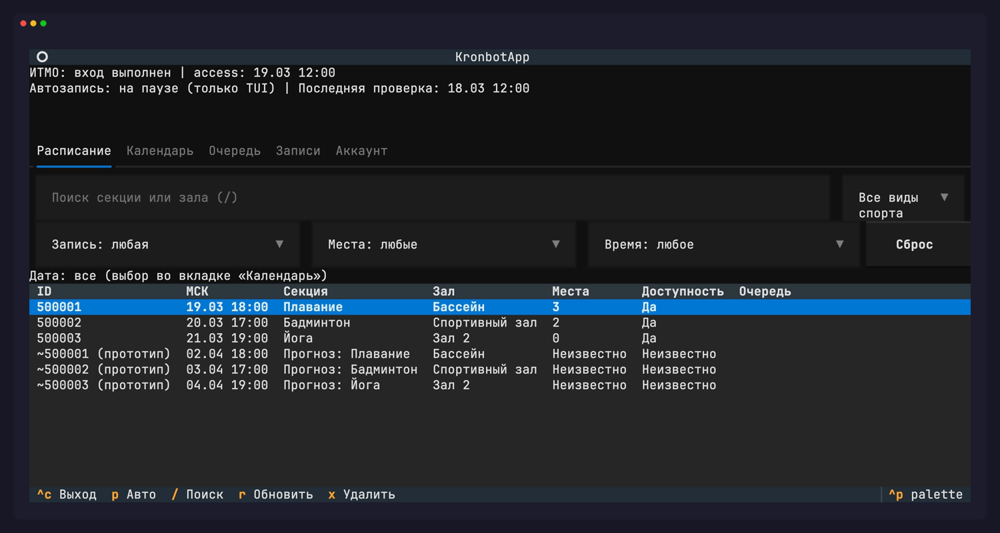

<h1 align="center">kronbot</h1>

<p align="center"><strong>Автозапись на физкультуру ИТМО из терминала</strong></p>
<p align="center">
  
  
  
</p>
<p align="center"><a href="#установка">Установка</a> · <a href="#вход">Вход</a> · <a href="#использование">Использование</a> · <a href="#приватность">Приватность</a></p>

> **Дисклеймер.** kronbot использует неофициально описанный API. Официально никто не разрешал ботов/скрипты такого плана (но соответственно никто и не запрещал), так что использование - на свой страх и риск. При сомнениях записывайтесь вручную через my.itmo.



## Что делает

- Показывает расписание на сегодня и следующие 14 дней и сохраняет очередь отдельно для каждого подтверждённого аккаунта.
- Записывает на выбранные занятия, проверяя календарь, доступность и попытки; для повторяющихся занятий можно заранее добавить прогноз на две недели вперёд.
- Доступен как терминальный интерфейс и CLI без TUI. При открытом TUI автозапись продолжает работать, если фоновая служба запущена и не приостановлена.
- После подтверждения записи удаляет её из очереди; предстоящие занятия доступны на вкладке «Записи».
- Сохраняет неопределённый исход при обрыве во время записи и не повторяет его автоматически.

## Установка

Нужны Python 3.12.4+ и [uv](https://docs.astral.sh/uv/getting-started/installation/) либо [pipx](https://pipx.pypa.io/stable/installation/). Целевые системы: macOS 14+, Windows 11, Debian-based дистрибутивы.

Установите пакет из [PyPI](https://pypi.org/project/kronbot/); скачивать исходный код не нужно:

```sh
uv tool install kronbot
```

Или, если используете pipx:

```sh
pipx install kronbot
```

После установки `kronbot` доступен из любого каталога: `kronbot` или `kronbot tui` открывает терминальный интерфейс, `kronbot --help` показывает CLI-команды. Если команда не найдена, выполните `uv tool update-shell` для uv или `pipx ensurepath` для pipx и откройте новый терминал.

Фоновая служба — основная часть приложения: TUI при первом запуске попытается установить и запустить её автоматически для текущего пользователя. Если установка не удалась, предупреждение подскажет проверить `kronbot service status`. Для установки из CLI выполните:

```sh
kronbot service install
```

Если установленная служба не работает, выполните `kronbot doctor`: команда проверит состояние и попытается запустить службу для текущего каталога. Она не устанавливает отсутствующую службу и не снимает паузу или ограничения доступа; при проблемах покажет дальнейшие действия.

TUI и CLI предупреждают, если служба отсутствует, остановлена или использует другой каталог состояния. Остановка и удаление службы: `kronbot service stop` и `kronbot service uninstall`.

Перед первым **веб-входом** отдельно установите Chromium:

```sh
kronbot browser install
```

Для веб-входа нужны графическая сессия и поддерживаемое Playwright окружение, позволяющее запустить Chromium с sandbox. При недостающих системных библиотеках Linux обратитесь к [инструкции Playwright](https://playwright.dev/python/docs/intro). Для входа с паролем или токеном Chromium и графический интерфейс не нужны.

Перед обновлением или удалением инструмента остановите службу: `kronbot service stop`. Обновите пакет командой `uv tool upgrade kronbot` или `pipx upgrade kronbot`, затем запустите службу через `kronbot service start`. Для полного удаления сначала выполните `kronbot service uninstall`, затем `uv tool uninstall kronbot` или `pipx uninstall kronbot`.

## Вход

Запустите `kronbot login` и выберите способ в меню или используйте команды ниже. Те же способы доступны на экране входа TUI (`kronbot`).

<details>
<summary>Веб-вход</summary>

Выполните `kronbot browser install`, затем выберите «Веб-вход» или запустите `kronbot login browser`. Откроется отдельный Chromium без вашего профиля и сохранённого SSO. Введите данные и пройдите дополнительные проверки на странице ITMO.ID. Если графическая сессия или защищённый запуск недоступны, выберите другой способ.
</details>

<details>
<summary>Логин и пароль</summary>

Выберите этот способ или запустите `kronbot login password`, затем введите логин и пароль по подсказкам. Если ITMO.ID требует дополнительную проверку, используйте веб-вход.
</details>

<details>
<summary>Refresh-токен My ITMO</summary>

1. На компьютере войдите на [my.itmo.ru](https://my.itmo.ru).
2. Нажмите F12, откройте **Application → Cookies → https://my.itmo.ru**.
3. Найдите cookie `auth.refresh_token.itmoId` и скопируйте её значение.
4. Выберите «Refresh-токен My ITMO» в TUI или запустите `kronbot login refresh-token` и вставьте значение в скрытое поле.

Токен секретный: никому его не передавайте. При обмене он ротируется: исходный может стать недействительным и завершить или нарушить прежнюю сессию. Не делите его с другим клиентом; при прерывании обмена исходный токен тоже может уже не работать. Если cookie отсутствует, используйте веб-вход или логин и пароль.
</details>

<details>
<summary>Access-токен My ITMO</summary>

1. На компьютере войдите на [my.itmo.ru](https://my.itmo.ru).
2. Нажмите F12, откройте **Application → Cookies → https://my.itmo.ru**.
3. Найдите cookie `auth._token.itmoId` и скопируйте её значение. Если оно начинается с `Bearer ` или `Bearer%20`, уберите префикс и оставьте только JWT. `KEYCLOAK_IDENTITY` — не этот токен. Название cookie приведено по [публичному примеру](https://ruddnevitmo.github.io/itmo-to-calendar/).
4. Выберите «Access-токен My ITMO» в TUI или запустите `kronbot login access-token` и вставьте JWT в скрытое поле.

Токен секретный: никому его не передавайте. Он краткоживущий и не продлевается автоматически; после истечения потребуется новый вход. Если cookie отсутствует, используйте веб-вход или логин и пароль.
</details>

После успешного входа отображается номер ИСУ, полученный из подтверждённого ответа My ITMO. Если сервис не вернул номер, показано «не указан»; OIDC-идентификатор аккаунта не подставляется вместо ИСУ. Для выхода выполните `kronbot logout`: это забывает локальную сессию, но не завершает серверную.

Программа не извлекает токены из существующего браузера; наличие cookie не гарантируется. Пароли и токены вводятся скрыто по запросу, не передавайте их в аргументах команд или переменных окружения. Вставляйте только свои токены.

## Использование

### TUI

Запустите `kronbot`. На вкладке «Расписание» перемещайтесь между элементами клавишей Tab, выбирайте фильтры стрелками и Enter. `/` переводит фокус в поиск по названию секции или зала; отдельно доступны вид спорта, возможность записи, наличие мест и диапазон времени. Кнопка «Сброс» очищает фильтры. Вид спорта проверяется через My ITMO, поэтому его выбор требует сетевого запроса.

На вкладке «Календарь» выберите дату стрелками и Enter или мышью; кнопки ◀/▶ переключают месяцы. Выбранная дата фильтрует расписание, остальные фильтры сохраняются. «Все даты» снимает фильтр даты, а «Сброс» в расписании — все фильтры. Отметки: **М** — свободные места и запись разрешена, **П** — прогноз, **О** — очередь, **А** — активная запись My ITMO. Цвет даты: зелёный — запись, жёлтый — очередь, синий — свободные места, фиолетовый — прогноз; при нескольких событиях действует этот порядок приоритета. Отметки строятся по загруженным данным и могут устареть; прогноз не означает подтверждённую запись.

Если в macOS Terminal не работают клики или прокрутка в TUI, включите в окне с `kronbot` пункт **Вид → Разрешить передачу событий мыши** (**View → Allow Mouse Reporting**). Рядом с ним должна появиться галочка. Подробнее — в [руководстве Apple](https://support.apple.com/guide/terminal/turn-on-mouse-reporting-trmlc69728a5/mac).

| Клавиша | Действие |
|---|---|
| Enter в расписании | Добавить выбранное занятие или строку прогноза в очередь |
| Enter или `x` во вкладке «Записи» | Подтвердить отписку в My ITMO |
| `x` в очереди | Удалить локальный элемент без отписки |
| `p` / `r` | Поставить автозапись на паузу или возобновить / обновить данные |
| `q`, Ctrl+C | Выйти |

На вкладке «Аккаунт» показаны номер ИСУ, срок входа, настройки ntfy и кнопки управления аккаунтом. При поиске текстовые клавиши вводятся в поле, а не запускают горячие команды.

### CLI

| Команда | Действие |
|---|---|
| `kronbot doctor` | Проверить и восстановить установленную фоновую службу |
| `kronbot schedule` | Свежее расписание и прогнозы повторений внизу |
| `kronbot bookings` | Текущие и предстоящие записи My ITMO на ближайшие 365 дней |
| `kronbot cancel [id]` | Подтвердить отписку от занятия в My ITMO |
| `kronbot queue add [id]` | Добавить в очередь без записи |
| `kronbot queue forecast ID` | Добавить прогноз повторения занятия через две недели |
| `kronbot queue list` | Локальная очередь |
| `kronbot queue diagnose [ID]` | Диагностика прогнозов без сетевого запроса; ID — прототип |
| `kronbot queue remove ID [--forecast\|--lesson]` | Удалить локально |
| `kronbot queue retry ID --verified-not-booked` | Разрешить повтор после самостоятельной проверки My ITMO |
| `kronbot book ID` | Одна попытка записи для указанного ID |
| `kronbot watch` | Ожидать места в переднем плане; остановка Ctrl+C |
| `kronbot ntfy set` / `status` / `disable` | Настроить, проверить состояние или отключить уведомления ntfy |
| `kronbot limits force` / `normal` / `status` | Включить, отключить или проверить форсирование локальных ограничений |

### Очередь и фоновая служба

После входа выполните следующие действия в терминале:

1. Выполните `kronbot schedule` и найдите ID нужного занятия. ID `500002` ниже — только пример, замените его на свой.
2. Добавьте существующее занятие командой `kronbot queue add 500002` или прогноз его повторения через две недели командой `kronbot queue forecast 500002`. В TUI нажмите Enter на нужной строке, в том числе строке прогноза. Проверьте очередь через `kronbot queue list`. Добавление само по себе не записывает на занятие.
3. Если TUI ещё не устанавливал службу, выполните `kronbot service install`. Служба запускается сразу и проверяет очередь; повторять установку для каждого занятия не нужно.
4. Проверяйте `kronbot service status` и `kronbot queue list`. Чтобы временно остановить службу, выполните `kronbot service stop`; чтобы запустить снова — `kronbot service start`. `kronbot service uninstall` останавливает и удаляет службу, но сохраняет очередь и вход.

Служба работает только пока компьютер включён, не спит и пользователь вошёл в систему. Она не будит компьютер. Для работы нужен действующий вход; после истечения сессии войдите снова. При ограничении доступа служба приостанавливает автозапись: после окончания блокировки явно выполните `kronbot service start`.
После аварийного завершения служба не перезапускается автоматически до следующего входа в систему; проверьте `kronbot service status` и при необходимости запустите её вручную. При сбое сохранения ротированного токена процесс ждёт восстановления записи, не отправляя повторный запрос со старым токеном.

Служба ненадолго блокирует каталог состояния во время проверки и освобождает его между проверками. Открытый TUI удерживает ту же блокировку до выхода и сам продолжает обработку очереди, пока служба включена. `p` ставит автозапись на паузу для TUI и службы; при остановленной службе `p` включает её только на время работы TUI. Если проверка уже идёт, TUI или другая команда могут сообщить, что состояние занято — повторите позже. `watch` также удерживает блокировку при работе в переднем плане.

Открытие новых записей ожидается ежедневно в 00:00 МСК на дату через две недели. Для прогноза выберите известное повторяющееся занятие: программа попытается найти через 14 дней единственное разовое занятие той же секции и с тем же временем начала. Если совпадение неоднозначно или данные недостаточны, запись не выполняется. Изменение преподавателя, зала и других необязательных параметров не мешает сопоставлению; различия показываются в диагностике и отправляются через ntfy, если он настроен. Подтверждённые API записи удаляются из очереди и отображаются во вкладке «Записи» / `kronbot bookings`.

Для сопоставления свободное посещение (тип `2`) и занятие с возможностью сдать нормативы (тип `6`) считаются совместимыми; изменение типа показывается в диагностике и уведомлении. Экстернат (тип `7`) не выбирается автоматически. Перед записью программа по-прежнему проверяет разрешение сервера, свободные места и попытки.

В расписании прогнозы показаны после реальных занятий и отмечены `~` и словом «прогноз». Дата прогноза — начало занятия-прототипа плюс 14 суток; указанный в CLI ID принадлежит именно реальному прототипу, а не будущему занятию. Используйте этот ID с `kronbot queue forecast ID`. Причину ожидания, результат сопоставления и отличия можно посмотреть во вкладке «Прогнозы» или командой `kronbot queue diagnose [ID]`; данные обновляются при проверке расписания. Прогноз не гарантирует появления занятия или свободного места.

При ожидающей очереди после полуночи МСК открывается пятиминутное окно проверок каждые 10 секунд. Если программа была недоступна в полночь, окно начнётся при первой возможности в этот день. На время окна локальный лимит 60 запросов в час автоматически отключается, что повышает риск ограничения доступа; серверные блокировки 403/429 по-прежнему соблюдаются. Затем возвращаются обычные настройки. Компьютер должен быть включён и не спать; окно и прогноз не гарантируют запись.

Текущее занятие и прогноз его повторения можно добавить одновременно. Если их ID совпадают, для удаления укажите `kronbot queue remove ID --lesson` или `--forecast`; после сопоставления прогноза с реальным занятием используется `--lesson`. В TUI это отдельные строки очереди.

Остановка службы или удаление из очереди не отменяют запись в My ITMO. Отменить её до начала занятия можно во вкладке «Записи» или командой `kronbot cancel ID`. Отписка от занятия семестровой группы отменяет **всю группу** и требует отдельного подтверждения; в CLI для неё нужен флаг `--whole-group`. Для запуска без интерактивного вопроса используйте `--yes`.

Если результат записи или отписки неизвестен (например, из-за обрыва или принудительного завершения), проверьте результат непосредственно в My ITMO: повторного автоматического запроса не будет. Неопределённые локальные элементы очереди остаются `uncertain`; только убедившись, что записи нет, разрешите новую попытку записи командой `kronbot queue retry 500002 --verified-not-booked` или через подтверждение в TUI.

Для удаления `uncertain` также обязателен `--verified-not-booked`. Сначала проверьте запись непосредственно в My ITMO: отсутствие в календаре программы не доказывает, что запрос не прошёл.

Коды выхода: `0` — выполнено, `1` — локальная или временная ошибка, `2` — неверные аргументы или отсутствие терминала, `3` — нужен вход либо действует сетевое ограничение, `4` — запись не подтверждена или операция неприменима. `watch` возвращает `4`, если остались только неопределённые исходы.

### Уведомления через ntfy

Уведомления необязательны и по умолчанию выключены. Подпишитесь в приложении [ntfy](https://ntfy.sh/) на свой топик, затем откройте «Аккаунт → ntfy» в TUI или выполните `kronbot ntfy set`. Введите полный HTTPS-адрес топика, например `https://ntfy.sh/my-private-topic`, заменив пример на длинное случайное имя. Затем введите необязательный bearer-токен ntfy; если токена нет, оставьте поле пустым. Для настройки через CLI закройте TUI, чтобы освободить блокировку состояния. Топик и токен не передавайте другим и не публикуйте: публичный топик могут читать все, кто знает его имя. Настройки хранятся вместе с локальным состоянием.

`kronbot ntfy status` показывает, включены ли уведомления; `kronbot ntfy disable` отключает их. Фоновая служба, TUI и CLI отправляют уведомления о подтверждённой записи, ошибке и прогнозе, который не удалось сопоставить до начала занятия. Доставка выполняется после обработки записи, не гарантируется и не влияет на её исход; статус настройки не подтверждает доставку. Повторяющиеся одинаковые ошибки не рассылаются до восстановления.

## Технические ограничения

Программа ограничивает спортивные запросы 60 в скользящий час; этот предел не означает разрешение от ИТМО. Технически никто не запрещает автоматизировать это через API, но вы используете приложение на свой страх и риск.

В исключительных случаях локальный предел и интервал проверки можно изменить кнопкой **«Аккаунт → Включить форсирование»** в TUI или командой `kronbot limits force` в CLI после подтверждения предупреждения. Для неинтерактивного запуска используется `kronbot limits force --confirm-risk`; вернуть обычный режим можно через `kronbot limits normal`. Форс сохраняется в состоянии и действует также на фоновую службу: предел 60 запросов в час отключается, интервал автопроверки сокращается со 120 до 10 секунд. Это повышает риск ограничения доступа и не подтверждает разрешение ИТМО на автоматизацию. Серверные блокировки после 403/429 и проверки неопределённого исхода остаются в силе. Время окончания ограничения показывается в часовом поясе системы с UTC-смещением; расписание по-прежнему отображается в МСК.

## Приватность

Состояние хранится на локальном диске: `KRONBOT_STATE_DIR`, либо `$XDG_CONFIG_HOME/kronbot` / `~/.config/kronbot` на macOS и Linux, `%LOCALAPPDATA%\\kronbot` на Windows. Не используйте общую или синхронизируемую папку. Один процесс держит блокировку каталога.

На POSIX состояние не шифруется: каталог `0700`, файлы `0600`. На Windows используется пользовательский DPAPI и проверка ACL; не запускайте программу администратором. Не публикуйте `state.json` и резервные копии: они содержат токены. Пароли, cookie и коды авторизации не сохраняются.

## Разработчикам

Получите исходный код и перейдите в каталог проекта:

```sh
git clone https://github.com/citr00n/kronbot.git
cd kronbot
uv sync --locked
```

Запускайте версию из локального каталога через `uv run --locked kronbot` (TUI) или, например, `uv run --locked kronbot --help` (CLI). TUI также попытается установить фоновую службу; перед разработкой проверьте существующую службу через `kronbot service status`.

Для установки локальной версии как инструмента используйте `uv tool install .` или `pipx install .` из корня проекта. Перед переустановкой остановите службу, после неё запустите снова.

Источники контракта и поведения: [my-itmo-api](https://github.com/alllexey-dev/my-itmo-api) и [ITMO.Widgets Agent](https://github.com/alllexey-dev/itmo-widgets-agent). Сервер, pairing и push-события исходного агента не используются. Тесты не требуют аккаунта ИТМО:

```sh
uv run --locked pytest -q tests/test_cli.py
uv run --locked pytest -q -m "not browser"
uv run --locked playwright install chromium
uv run --locked pytest -q tests/test_browser.py
```

CI запускается для PRов, но не после слияния в `main`. Релизный workflow отдельно вызывает CI, проверяет тег и версию в `pyproject.toml`, собирает пакет и публикует его в PyPI через Trusted Publishing, после чего создаёт GitHub Release. Стабильный тег — `vX.Y.Z`, alpha — `vX.Y.ZaN`, dev — `vX.Y.Z.devN`; alpha и dev отмечаются на GitHub как prerelease.

Для каждого GitHub Release автоматически формируется описание изменений со ссылками на включённые pull request и прямые коммиты. Уведомление о новой версии содержит ссылку на соответствующий релиз.

## Лицензия

[MIT](LICENSE), Copyright (c) 2026 citr0n.
